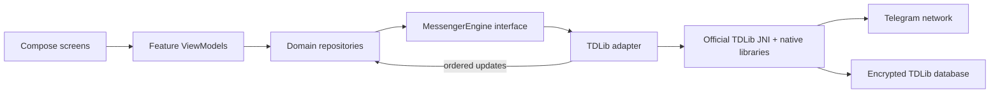

# Proposed architecture

## Principles

- Kotlin and Jetpack Compose for Android UI.
- Keep the TDLib boundary behind an application-owned interface so generated TDLib classes do not leak into UI or domain logic.
- Consume TDLib's ordered asynchronous updates in one adapter, convert them to typed app events, and expose immutable `StateFlow` state to feature ViewModels.
- Make the UI a private-messaging client with Chats, Contacts, Calls, and Settings as the main destinations.
- Avoid storing authentication inputs. Protect only the TDLib database encryption key using Android Keystore.

## Module layout

```text
:app                 Android entry point, navigation, dependency wiring, permissions
:core:design         Morrow colors, typography, components, icons
:core:model          UI-safe user/chat/message/auth/call models
:core:tdlib          Official TDLib adapter, authorization and update routing
:core:database       Local app preferences and non-sensitive metadata only
:feature:auth        Phone, code, email, registration, and 2FA screens
:feature:chats       Chat list, conversation, media picker, typing and receipts
:feature:contacts    Telegram contacts and consent-based device contact matching
:feature:calls       One-to-one call UI and Android audio/video integration
:feature:settings    Account, privacy, notifications, and session controls
```

For the first prototype these can live in one Android module with package boundaries, then split into Gradle modules as the TDLib integration stabilizes.

## Data flow



The adapter should own the TDLib client lifecycle, initialization parameters, auth-state reducer, chat/user caches, and update translation. Repositories expose operations such as `submitPhoneNumber`, `submitCode`, `submitTwoStepPassword`, `observeChats`, `observeMessages`, `sendText`, `markRead`, and `searchMessages`.

## Prototype scope

1. Boot TDLib with app credentials, internal storage paths, and a Keystore-protected database key.
2. Render authorization states and submit phone number, code, and 2FA password through TDLib.
3. Load only eligible private one-to-one conversations in the primary Chats list.
4. Open one private conversation, page recent history, display text and send a text message.
5. Handle incoming updates and send-result state so the prototype remains consistent with other Telegram clients.

## Security decisions

- Keep `api_id` and `api_hash` in local, ignored Gradle properties for development; provide CI secrets for builds.
- Do not persist phone codes, 2FA passwords, or user-entered auth data.
- Store the random TDLib DB encryption key only as a Keystore-wrapped blob in app-private storage.
- Disable cleartext traffic and avoid logging message bodies, credentials, phone numbers, or TDLib database keys.
- Request contacts, microphone, and camera access only when the matching feature is invoked and explain the use first.
- Rely on TDLib's ordered updates for message status, typing, and read state; do not synthesize or suppress those signals.
